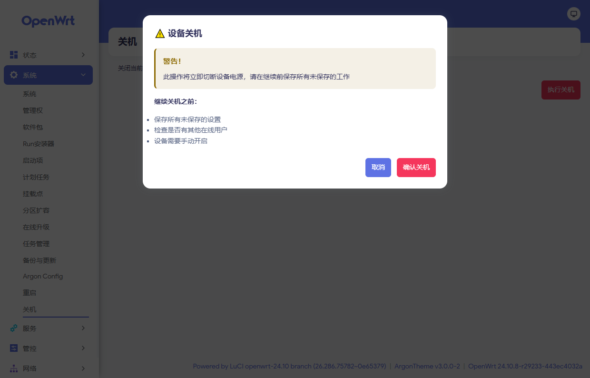

# LuCI App Poweroff

[简体中文](README.md) | **English**

A LuCI application that provides a one-click "Power Off" page for OpenWrt / ImmortalWrt.

> ⚠️ The device will not restart automatically after powering off; you need to power-cycle it manually.



## Features

- Adds a "Power Off" page to the LuCI System menu with a confirmation dialog to prevent accidental shutdowns
- Warns about unsaved UCI configuration changes before powering off
- Executes `/sbin/poweroff` through rpcd, following LuCI's ACL permission model
- Works with both light and dark LuCI themes, without custom colors or inline styles
- Ships a Simplified Chinese translation (`luci-i18n-poweroff-zh-cn`)
- Architecture-independent package (`all`)

## Installation

### From Releases

1. Download the package matching your system from [Releases](https://github.com/Arthur97172/luci-app-poweroff/releases).
2. Upload it to the device (e.g. `/tmp`) and install it.

OpenWrt 24.10 and earlier:

```sh
opkg install /tmp/luci-app-poweroff_*.ipk
# Optional: Simplified Chinese translation
opkg install /tmp/luci-i18n-poweroff-zh-cn_*.ipk
```

OpenWrt 25.12+:

```sh
apk add --allow-untrusted /tmp/luci-app-poweroff-*.apk
# Optional: Simplified Chinese translation
apk add --allow-untrusted /tmp/luci-i18n-poweroff-zh-cn-*.apk
```

3. Refresh the LuCI page; the entry appears under "System → Power Off".

### Build from source

```sh
cd openwrt
./scripts/feeds update -a
./scripts/feeds install -a
git clone https://github.com/Arthur97172/luci-app-poweroff.git package/luci-app-poweroff
make menuconfig   # LuCI → Applications → luci-app-poweroff
make package/luci-app-poweroff/compile V=s
```

The resulting packages are placed in `bin/packages/<arch>/luci/`. The repository's GitHub Actions workflow builds both `.ipk` and `.apk` packages automatically.

## Compatibility

| System | Package format | Package manager |
| --- | --- | --- |
| OpenWrt / ImmortalWrt 24.10 and earlier | `.ipk` | opkg |
| OpenWrt / ImmortalWrt 25.12+ | `.apk` | apk |

- Dependency: `luci-base` (which already provides `rpcd` and `rpcd-mod-file`)
- Architecture: `all`
- The menu entry is only shown when `/sbin/poweroff` exists (BusyBox `poweroff` is enabled by default)

## Usage

1. Open "System → Power Off".
2. Click "Perform Power Off".
3. Click "Confirm Power Off" in the confirmation dialog.

If there are unsaved configuration changes in the current session, a warning banner is shown. After powering off, the device must be turned on manually.

## Permissions

The application executes `/sbin/poweroff` through rpcd's `file.exec`. The `luci-app-poweroff` ACL group only grants:

- Executing `/sbin/poweroff` with `exec`
- Calling the `exec` method of the `file` ubus object

`root` has full access by default. To let other users use this page, assign them the ACL group under "System → Administration".

## Internationalization

- The interface language follows the LuCI language setting; English is shown when no translation package is installed.
- The Simplified Chinese translation is provided by the separate `luci-i18n-poweroff-zh-cn` package.

## Directory layout

```
.
├── .github/workflows/build.yml                  # CI: build ipk / apk and publish
├── htdocs/luci-static/resources/view/system/
│   └── poweroff.js                              # Frontend view
├── po/
│   ├── templates/poweroff.pot                   # Translation template
│   └── zh_Hans/poweroff.po                      # Simplified Chinese translation
├── root/usr/share/luci/menu.d/                  # Menu definition
├── root/usr/share/rpcd/acl.d/                   # ACL definition
├── Makefile
└── LICENSE
```

## License

[GPL-3.0-only](LICENSE)
